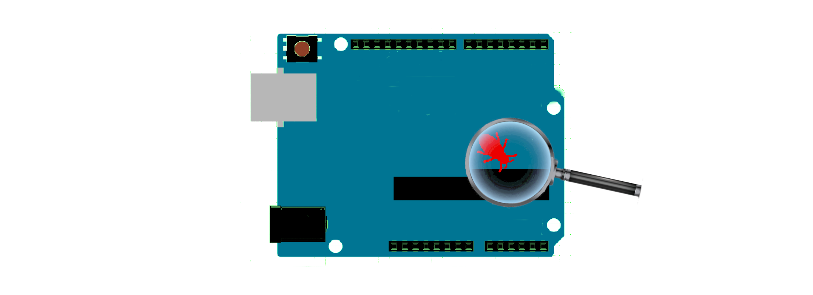

# dw-link 

This Arduino sketch turns your Arduino UNO into a hardware debugger for the classic ATtinys and the ATmegaX8s, such as the ATmega328. It gives you a chance to find out how it feels to use a source-level debugger on an Arduino Uno or an ATtiny board. Do you want to give it a try? Use the [**Quick-start Guide**](https://felias-fogg.github.io/dw-link/quickstart-Arduino-IDE2/) to see if it works for you. 

From version 7 on, the protocol has been changed from [GDB RSP](https://sourceware.org/gdb/current/onlinedocs/gdb.html/Remote-Protocol.html) to a variant of the JTAGICE mkII protocol ([AVR067](https://www.microchip.com/en-us/application-notes/an2587-1)), which implies that you necessarily have to use [PyAvrOCD](https://pyavrocd.io) as a GDB server. If you want to connect GDB to dw-link using only the serial line, you need to fall back to version 6.

This repository, which is organized as an Arduino library, contains the following directories:

* [**src**](src/) contains an empty header file so that it fits the format of a library,
* [**examples**](examples/) contains the [dw-link](examples/dw-link/) sketch and the [testprobe](examples/testprobe/) sketch, which can be used to to run tests on a freshly assembled dw-link probe,
* [**docs**](docs/) contains the documentation files for the [manual](https://felias-fogg.github.io/dw-link/),
* [**extras**](extras/) contains the folder pcb with design data (KiCad) for the optional dw-link probe.

The cover picture was designed based on vector graphics by [captainvector at 123RF](https://de.123rf.com/profile_captainvector).

