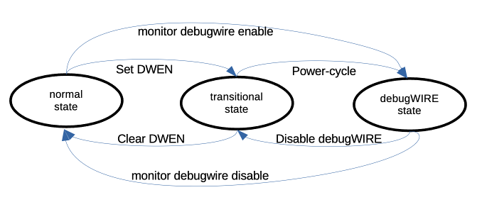

# Background

Before we start the excursion into the world of debugging, some background on the [debugWIRE interface](#the-debugwire-interface) is provided, sketching the physical properties of the debugWIRE protocol. With that out of the way, we have a look at what we need on the hardware side.  You need an Arduino UNO (or something equivalent) as the [hardware debugger](requirements.md#the-hardware-debugger) and a [target chip or board that understands debugWIRE](requirements.md#mcus-with-debugwire-interface), i.e., a classic ATtiny or an ATmegaX8. Then, you have to [install the debugger firmware on the UNO and tghe debugging software](installation.md). If that is all done, you need to [set up the hardware for a debugging session](setup.md#setting-up-the-hardware).

If you have performed all the above steps, then the setup should look like the following picture.


Your development machine, the *host*, is connected to the UNO acting as a *hardware debugger* over the usual USB connection. The hardware debugger in turn is connected to the *target system*, whereby the *debugWIRE protocol* is used for communication. Now you can start the [debugging process](https://pyavrocd.io/debugging/).

The physical connection between the hardware debugger and the target, as described in the [section about the hardware setup](setup.md#setting-up-the-hardware), is something that might need some enhancements. Instead of six jumper wires, you may want to have a more durable connection. This is covered in the part about [*a better hardware debugger*](better.md). 

## The debugWIRE interface

The basic idea of debugWIRE is that the RESET line is used as a communication line between the target system (the system you want to debug) and the hardware debugger, which in turn can then communicate with the development machine or host. The idea of using only a single line that is not used otherwise is very cool because it does not waste any of the other pins for debugging purposes (as does, e.g., the [JTAG interface](https://en.wikipedia.org/wiki/JTAG)). However, using the RESET line as a communication channel means, of course, that one cannot use the RESET line to reset the MCU anymore. Furthermore, one cannot any longer use [ISP programming](https://en.wikipedia.org/wiki/In-system_programming) to upload new firmware to the MCU or change the fuses of the MCU. 

With respect to the debugWIRE protocol there are basically three states your MCU could be in:

1. The **normal** **state** in which the DWEN (debugWIRE enable) [fuse](https://microchipdeveloper.com/8avr:avrfuses) is disabled. In this state, you can use ISP programming to change fuses and to upload programs. By enabling the DWEN fuse, one reaches the **transitional** **state**.
2. The **transitional** **state** is the state in which the DWEN fuse is enabled. In this state, you could use ISP programming to disable the DWEN fuse again, to reach the **normal state**. By *power-cycling* (switching the target system off and on again), one reaches the **debugWIRE** **state**.
3. The **debugWIRE** **state** is the state in which you can use the debugger to control the target system. If you want to return to the **normal** **state**, a particular debugWIRE command leads to the **transitional state**, from which one can reach the **normal state** using ordinary ISP programming by disabling the DWEN fuse.



The hardware debugger will take care of bringing you from *normal* state to *debugWIRE* state when you type  the command ```monitor debugwire enable``` . In fact, when using the Arduino IDE 2, this will be done in the background for you. After the hardware debugger has enabled the DWEN fuse, the system LED will flash in a particular pattern, which signals that you should power-cycle the target. Further, in the GDB debugger, a message will be shown that asks you to power-cycle the target system. If the hardware debugger powers the target, it will power-cycle automatically. This transition is only necessary once. The next time, when you start a debugging session, the target system is already in the debugWIRE state and nothing needs to be done. 

When you are done with debugging and you want to get the target system back into the normal state, you must type the command ```monitor debugwire disable``` just before exiting the debugger.

